# CareNest – System Architecture & Technical Blueprint

## 1. Executive Summary & Architectural Philosophy

**CareNest** is a patient-centric elderly care and medication management platform designed around the principles of **dual-generation usability**, **graceful degradation**, **resilient asynchronous orchestration**, and **uncompromising patient sovereignty**.

The platform is engineered to resolve a core dilemma in geriatric digital health:
1. **Elderly Patients** require interfaces with near-zero cognitive friction, large tactile targets (56px+), high visual contrast (WCAG AAA), auditory assistance, intuitive physical metaphors, and zero patronizing design.
2. **Family Administrators & Caregivers** require comprehensive oversight, transparent audit trails, automated escalation protocols, realtime presence indicators, and proactive alerts without hovering invasively over the senior's autonomy.
3. **Visiting Nurses & Clinicians** require authoritative medication schedules, consultation logs, clinical contraindication warnings, and handover tracking.

### Core Architectural Tenets
- **Modular Monolith First**: A single, strictly bounded codebase with clear domain separation (NestJS/Next.js full-stack TypeScript architecture) to maximize developer velocity, type safety, and transactional consistency while avoiding premature microservice complexity.
- **Patient-Centric Sovereignty**: All data access radiates from patient consent. Permissions are explicitly scoped, auditable, and revocable by the patient or their legally appointed administrator.
- **Decoupled Telephony & Notification Adapters**: Automated phone calls, SMS, and emails run through abstract provider interfaces (`TelephonyProvider`, `EmailProvider`) powered by Redis-backed durable queues (BullMQ), completely decoupled from HTTP request-response cycles.
- **Adherence State Machine with Concurrency Guardrails**: Dose confirmations, whether submitted via touch UI, voice recognition, or telephony DTMF keypad, undergo atomic transactions with distributed locking (Redis Redlock / PostgreSQL row-level locks) to prevent double-dosing or phantom alerts.

---

## 2. Technology Stack Selection & Rationale

| Layer | Selected Technology | Technical & Architectural Rationale |
| :--- | :--- | :--- |
| **Frontend Framework** | **Next.js 14+ (App Router, React 18/19, TypeScript)** | Server-side rendering (SSR) for lightning-fast initial load on low-power senior tablets; Server Components for secure data fetching; React Suspense for smooth loading states; strict static typing across client and server. |
| **Styling & Design System** | **Tailwind CSS + Headless UI + Custom Tokens** | Exact implementation of the CareNest design system specified in `DESIGN.md`: `#00523C` Deep Sage primary, `#455F87` Trust Navy secondary, `#F6FAFF` surface, `#D97706` amber alerts, `#DC2626` urgent rose, WCAG AAA compliant typography (`Plus Jakarta Sans`), and 56px+ touch targets. |
| **State Management** | **Zustand + TanStack Query (React Query v5)** | TanStack Query handles server state caching, optimistic UI updates (instant "Taken" feedback), automatic background refetching, and offline cache hydration. Zustand manages local client accessibility settings (text scale, high-contrast, speech synthesis states). |
| **Accessibility & Voice** | **Web Speech API (Synthesis & Recognition) + Google Gemini Flash API** | Built-in browser Web Speech API for zero-latency screen reading and voice commands; server-side Google Gemini Flash API for complex multi-turn voice queries and natural language caregiver summaries. |
| **Backend & API Layer** | **Next.js Route Handlers + Modular Service Architecture (or NestJS API)** | Clean separation of concerns: Controllers/Route Handlers $\rightarrow$ Domain Services $\rightarrow$ Data Access Repositories $\rightarrow$ External Adapters. Zod schemas validate every boundary. |
| **Database & ORM** | **PostgreSQL 16 + Prisma ORM** | ACID-compliant relational integrity; native JSONB support for flexible device payloads and audit diffs; Prisma provides compile-time end-to-end type safety, migration tracking, and rich query modeling. |
| **Cache & Job Queue** | **Redis 7.2 + BullMQ** | High-throughput durable queue for medication schedules, delayed reminders (e.g. "snooze for 15 mins"), recurring cron sweeps, caregiver escalation workflows, and distributed locking. |
| **Telephony Integration** | **Twilio Voice & Messaging API (behind TelephonyAdapter)** | Enterprise voice gateway: programmable TwiML IVR for interactive voice reminders, DTMF digit collection (keypad 1 to confirm), text-to-speech voice prompts, and direct call bridging to caregivers. |
| **Email Service** | **Resend / SendGrid (behind EmailAdapter)** | High deliverability transactional emails with React Email templates for daily care summaries, invitation codes, missed dose alerts, and appointment reminders. |
| **Object Storage** | **AWS S3 / Supabase Storage / Cloudflare R2** | Pre-signed URL uploads for medical documents, lab results, discharge summaries, and caregiver profile avatars. |
| **Audit & Observability** | **Pino + OpenTelemetry + Winston + Sentry** | Structured JSON logging with correlation IDs (`x-correlation-id`), distributed tracing across job workers, and automated error tracking. |

---

## 3. High-Level System Architecture Diagram

```mermaid
graph TD
    subgraph ClientLayer ["Client Devices & Accessibility Layer"]
        EP["Elderly Patient<br/>(Tablet / Mobile / Desktop Web)<br/>56px Touch Targets, High Contrast, Web Speech"]
        FA["Family Admin & Members<br/>(Mobile & Web Dashboard)<br/>Real-Time Care Circle, Notes, Vitals"]
        CG["Caretakers & Nurses<br/>(Caregiver Portal)<br/>Routines, Shift Handover, Observations"]
        PSTN["Landline / Feature Phone<br/>(Interactive Voice Call & DTMF 1-Click Confirmation)"]
    end

    subgraph EdgeLayer ["Edge Gateway & Security"]
        CDN["CDN & Edge Caching<br/>(Cloudflare / Vercel Edge)"]
        WAF["Web Application Firewall & Rate Limiting"]
        SSL["TLS 1.3 Termination & Security Headers"]
    end

    subgraph AppServer ["Application Monolith (Next.js / Node.js Engine)"]
        subgraph APILayer ["API Routing & Security Middleware"]
            AuthMid["Auth & Session Guard (JWT/Argon2)"]
            RBACMid["RBAC & Patient Consent Gate"]
            AuditMid["Audit Logging Interceptor"]
            RateLimit["Per-Patient Rate Limiter"]
        end

        subgraph Modules ["Domain Core Modules"]
            AuthMod["Auth & Profile Module"]
            MedMod["Medication & Schedule Engine"]
            AdhereMod["Adherence & Verification State Machine"]
            CareMod["Care Circle & Collaboration Module"]
            ApptMod["Appointment & Ride Transport Module"]
            VitalMod["Health Vitals & Symptom Logs"]
            VoiceMod["Voice Assistant & NLP Processing"]
            EmergMod["Emergency SOS Dispatch Service"]
        end

        subgraph Adapters ["External Service Adapters (Hexagonal Ports)"]
            TelAdapter["ITelephonyAdapter<br/>(Twilio Voice / Webhook Handler)"]
            MailAdapter["IEmailAdapter<br/>(Resend / React Email)"]
            StorageAdapter["IStorageAdapter<br/>(S3 / R2 Pre-signed URLs)"]
            SMSAdapter["ISMSAdapter<br/>(Twilio SMS / Fallback)"]
            AIAdapter["IAssistantAdapter<br/>(Gemini Flash Multimodal)"]
        end
    end

    subgraph BackgroundWorker ["Asynchronous Job & Orchestration Layer (BullMQ)"]
        SchedQueue["Medication Schedule Engine<br/>(Generates Daily Dose Occurrences)"]
        RemindQueue["Reminder Delivery Worker<br/>(Quiet Hours, Retries, Snooze)"]
        EscalQueue["Missed-Dose Escalation Engine<br/>(Tiers 1, 2, 3 Alert Cascade)"]
        TelephonyQueue["Outbound Telephony Dispatcher<br/>(Handles TwiML Calls & Fallback)"]
    end

    subgraph DataPersistence ["Enterprise Data & Caching Tier"]
        PG[(PostgreSQL Primary<br/>ACID Transactions, Row Locks,<br/>Audit Log Storage)]
        Redis[(Redis In-Memory Store<br/>Distributed Locks, BullMQ Queues,<br/>Presence Indicators, Session Cache)]
        S3[(Secure Document Storage<br/>AES-256 Encrypted Prescriptions & Docs)]
    end

    subgraph ExternalGateways ["External Infrastructure Gateways"]
        TwilioAPI["Twilio Voice / SMS Gateway"]
        EmailGateway["Resend Transactional Mailer"]
        OmronHub["Omron / BLE Health Device Gateway"]
        GeminiCloud["Google Gemini AI Platform"]
    end

    %% Client connections
    EP -->|HTTPS / WSS| CDN
    FA -->|HTTPS| CDN
    CG -->|HTTPS| CDN
    PSTN <-->|Telephony Call / Audio| TwilioAPI

    CDN --> WAF --> SSL --> APILayer
    AuthMid --> RBACMid --> AuditMid --> Modules

    %% Modules to Adapters & DB
    Modules --> Adapters
    Modules -->|Prisma Client / Transactions| PG
    Modules -->|Publish Events / Queue Tasks| Redis

    %% Workers
    Redis <--> BackgroundWorker
    BackgroundWorker -->|Update Status / Adherence| PG
    BackgroundWorker --> Adapters

    %% Adapters to External
    TelAdapter <--> TwilioAPI
    MailAdapter --> EmailGateway
    StorageAdapter <--> S3
    VoiceMod --> AIAdapter <--> GeminiCloud
    VitalMod <--> OmronHub
```



---

## 4. Architectural Boundaries & Domain Isolation

To maintain high maintainability and prevent the dreaded "spaghetti architecture", CareNest follows **Domain-Driven Design (DDD)** packaged as a **Modular Monolith**:

```
src/
├── app/                  # Next.js App Router (UI Pages & API Route Handlers)
├── core/                 # Shared domain interfaces, error primitives, base entities
├── modules/              # Bounded contexts with zero direct cross-module DB queries
│   ├── auth/             # Authentication, Passcodes, Sessions, RBAC
│   ├── patients/         # Patient master profile, emergency contacts, medical history
│   ├── medications/      # Medication registry, dosage, stock, duplicate checks
│   ├── adherence/        # Dose occurrence generation, verification state machine
│   ├── care-circle/      # Membership, invites, role delegation, notes board
│   ├── appointments/     # Clinician visits, ride escorts, reminder triggers
│   ├── vitals/           # Blood pressure, glucose, hydration, telemetry logs
│   ├── telephony/        # Twilio TwiML IVR, keypad parsers, call lifecycle
│   ├── notifications/    # Multi-channel dispatcher, quiet hours, templates
│   ├── voice/            # Voice query parser, speech synthesis, Gemini integration
│   ├── emergency/        # SOS trigger, 1-click caretaker calls, audit logging
│   └── reporting/        # Weekly adherence summaries, clinical export PDF
├── jobs/                 # BullMQ asynchronous workers & recurring schedulers
├── infrastructure/       # Prisma client, Redis client, database migrations
└── adapters/             # Implementations of external service interfaces
```

### Module Boundary Enforcement Rules:
1. **No Cross-Module Database Joins**: Modules communicate exclusively through exported Service Interfaces (e.g., `AdherenceService` calls `NotificationService.triggerReminder()`, never directly inserting into `notifications` table).
2. **Event-Driven Asynchronous Decoupling**: Non-blocking actions (e.g. logging an adherence event, broadcasting caretaker presence, firing email notifications) emit internal domain events (`DoseCompletedEvent`, `DoseMissedEvent`) processed by background queues.
3. **Idempotency Everywhere**: All dose confirmation, notification delivery, and webhook ingestion endpoints require an `Idempotency-Key` or derive a deterministic hash from `(patient_id, dose_occurrence_id, attempt_number)` to eliminate race conditions.
