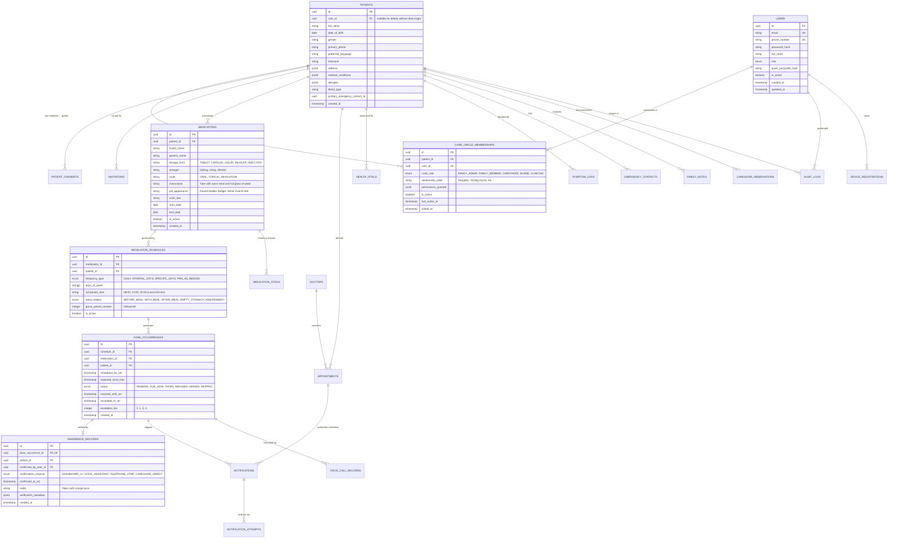

# CareNest – Relational Database Schema & Data Architecture

## 1. Relational Database Design Overview

The CareNest relational database is built on **PostgreSQL 16** using **Prisma ORM**. It is strictly modeled to satisfy:
1. **Patient Sovereignty**: All records connect back to a `patient_id`. Multi-tenant data segregation ensures no family member or caretaker can query a record without explicit active consent.
2. **Deterministic Medication State Machine**: Separation between **Medication** (the drug record), **MedicationSchedule** (the recurring rule/cron), **DoseOccurrence** (the specific expected instance in time), and **AdherenceRecord** (the immutable record of action taken).
3. **Timezone Integrity**: Patients, family members, and clinics may reside across multiple timezones. All schedules store the patient's local timezone (e.g. `America/New_York`) and calculate dose occurrences in UTC with local timestamp projections.
4. **Audit Immutability**: Critical healthcare decisions, permission grants, dose status changes, and emergency SOS triggers write immutable audit records with actor attribution, previous/new value diffs, and IP addresses.

---

## 2. Entity Relationship Diagram (ERD)

---

## 3. Detailed Entity Definitions & Constraints

### 3.1 Core Authentication & Patient Sovereignty

#### Table: `users`
- `id` (UUID, Primary Key, `gen_random_uuid()`)
- `email` (VARCHAR(255), Unique, Nullable for phone-only seniors)
- `phone_number` (VARCHAR(32), Unique, E.164 formatted `+1234567890`)
- `password_hash` (VARCHAR(255), Argon2id hash)
- `quick_passcode_hash` (VARCHAR(255), 4-6 digit numeric PIN for senior tablet quick unlock, salted/hashed)
- `full_name` (VARCHAR(150), Not Null)
- `avatar_url` (VARCHAR(512), Nullable)
- `system_role` (ENUM: `PATIENT`, `FAMILY_ADMIN`, `FAMILY_MEMBER`, `CARETAKER`, `HEALTHCARE_PROFESSIONAL`, `SUPER_ADMIN`)
- `is_active` (BOOLEAN, Default `true`)
- `phone_verified` (BOOLEAN, Default `false`)
- `email_verified` (BOOLEAN, Default `false`)
- `failed_login_attempts` (INTEGER, Default 0)
- `locked_until` (TIMESTAMP, Nullable)
- `created_at` / `updated_at` (TIMESTAMP WITH TIME ZONE, Default `NOW()`)
- *Indexes*: `idx_users_email`, `idx_users_phone`, `idx_users_system_role`

#### Table: `patients`
- `id` (UUID, Primary Key, `gen_random_uuid()`)
- `user_id` (UUID, Nullable, Foreign Key $\rightarrow$ `users.id`, for elderly users with active digital login credentials)
- `full_name` (VARCHAR(150), Not Null)
- `date_of_birth` (DATE, Not Null)
- `gender` (VARCHAR(30))
- `primary_phone` (VARCHAR(32), Not Null, primary line for telephone reminders)
- `preferred_language` (VARCHAR(10), Default `'en-US'`)
- `timezone` (VARCHAR(50), Not Null, e.g. `'America/New_York'`)
- `address` (JSONB, structured: street, unit, city, state, postal_code, lat, lng)
- `medical_conditions` (JSONB, array of strings: `["Type 2 Diabetes", "Hypertension"]`)
- `allergies` (JSONB, array of objects: `[{ "substance": "Penicillin", "severity": "SEVERE", "reaction": "Anaphylaxis" }]`)
- `blood_type` (VARCHAR(10), e.g. `'O+'`)
- `high_contrast_preference` (BOOLEAN, Default `false`)
- `text_scale_preference` (NUMERIC(3,2), Default `1.00`, up to `1.25`)
- `audio_readout_enabled` (BOOLEAN, Default `true`)
- `quiet_hours_start` (TIME, Default `'22:00'`)
- `quiet_hours_end` (TIME, Default `'07:00'`)
- `created_at` / `updated_at` (TIMESTAMP WITH TIME ZONE)
- *Indexes*: `idx_patients_user_id`, `idx_patients_primary_phone`

#### Table: `care_circle_memberships`
- `id` (UUID, Primary Key)
- `patient_id` (UUID, Foreign Key $\rightarrow$ `patients.id`, ON DELETE CASCADE)
- `user_id` (UUID, Foreign Key $\rightarrow$ `users.id`, ON DELETE CASCADE)
- `circle_role` (ENUM: `FAMILY_ADMIN`, `FAMILY_MEMBER`, `CARETAKER`, `NURSE`, `CLINICIAN`)
- `relationship_label` (VARCHAR(50), e.g. `'Daughter'`, `'Visiting Nurse'`)
- `is_primary_caregiver` (BOOLEAN, Default `false`)
- `can_manage_medications` (BOOLEAN, Default `false`)
- `can_manage_appointments` (BOOLEAN, Default `false`)
- `can_view_vitals` (BOOLEAN, Default `true`)
- `can_view_records` (BOOLEAN, Default `true`)
- `receive_emergency_alerts` (BOOLEAN, Default `true`)
- `receive_missed_dose_calls` (BOOLEAN, Default `false`)
- `is_active` (BOOLEAN, Default `true`)
- `last_active_at` (TIMESTAMP WITH TIME ZONE)
- `joined_at` (TIMESTAMP WITH TIME ZONE, Default `NOW()`)
- *Unique Constraint*: `unique_patient_user_membership (patient_id, user_id)`
- *Indexes*: `idx_circle_patient`, `idx_circle_user`, `idx_circle_active`

#### Table: `patient_consents`
- `id` (UUID, Primary Key)
- `patient_id` (UUID, Foreign Key $\rightarrow$ `patients.id`)
- `granted_to_user_id` (UUID, Foreign Key $\rightarrow$ `users.id`)
- `consent_type` (ENUM: `FULL_HEALTHCARE_PROXY`, `MEDICATION_MANAGEMENT`, `VITALS_VIEW_ONLY`, `APPOINTMENT_ESCORT`)
- `status` (ENUM: `GRANTED`, `REVOKED`, `EXPIRED`)
- `granted_at` (TIMESTAMP WITH TIME ZONE)
- `revoked_at` (TIMESTAMP WITH TIME ZONE, Nullable)
- `digital_signature_hash` (VARCHAR(255))
- `revocation_reason` (TEXT, Nullable)

#### Table: `invitations`
- `id` (UUID, Primary Key)
- `patient_id` (UUID, Foreign Key $\rightarrow$ `patients.id`)
- `invited_by_user_id` (UUID, Foreign Key $\rightarrow$ `users.id`)
- `invitee_email` (VARCHAR(255), Nullable)
- `invitee_phone` (VARCHAR(32), Nullable)
- `invite_code` (VARCHAR(12), Unique, 6-8 digit alphanumeric token)
- `circle_role` (ENUM matching `care_circle_memberships.circle_role`)
- `permissions_preset` (JSONB)
- `status` (ENUM: `PENDING`, `ACCEPTED`, `EXPIRED`, `REVOKED`)
- `expires_at` (TIMESTAMP WITH TIME ZONE, e.g. 7 days from issue)
- `created_at` (TIMESTAMP WITH TIME ZONE)

---

### 3.2 Medication Management & Adherence State Machine

#### Table: `medications`
- `id` (UUID, Primary Key)
- `patient_id` (UUID, Foreign Key $\rightarrow$ `patients.id`)
- `brand_name` (VARCHAR(150), Not Null, e.g. `'Glucophage'`)
- `generic_name` (VARCHAR(150), Not Null, e.g. `'Metformin'`)
- `rx_norm_code` (VARCHAR(50), Nullable, standardized clinical identifier)
- `dosage_form` (ENUM: `TABLET`, `CAPSULE`, `LIQUID`, `INHALER`, `INJECTION`, `PATCH`, `DROPS`)
- `strength` (VARCHAR(50), Not Null, e.g. `'500mg'`)
- `route` (VARCHAR(50), Default `'ORAL'`)
- `instructions` (TEXT, e.g. `'1 White Oval Tablet • Take with warm meal'`)
- `pill_appearance` (VARCHAR(100), e.g. `'White Oval Tablet with M 500 score'`)
- `pill_color` (VARCHAR(30), e.g. `'#FFFFFF'`)
- `pill_shape` (VARCHAR(30), e.g. `'OVAL'`, `'ROUND'`, `'CAPSULE'`)
- `indication` (VARCHAR(150), e.g. `'Blood Sugar'`, `'Hypertension'`)
- `prescribing_doctor_id` (UUID, Nullable, Foreign Key $\rightarrow$ `doctors.id`)
- `start_date` (DATE, Not Null)
- `end_date` (DATE, Nullable)
- `is_active` (BOOLEAN, Default `true`)
- `discontinued_reason` (TEXT, Nullable)
- `created_at` / `updated_at` (TIMESTAMP WITH TIME ZONE)
- *Indexes*: `idx_medications_patient`, `idx_medications_active`

#### Table: `medication_schedules`
- `id` (UUID, Primary Key)
- `medication_id` (UUID, Foreign Key $\rightarrow$ `medications.id`, ON DELETE CASCADE)
- `patient_id` (UUID, Foreign Key $\rightarrow$ `patients.id`)
- `frequency_type` (ENUM: `DAILY`, `EVERY_X_DAYS`, `SPECIFIC_WEEKDAYS`, `AS_NEEDED_PRN`)
- `interval_days` (INTEGER, Default 1)
- `days_of_week` (INTEGER[], Array of 0-6 where 0=Sunday)
- `time_of_day_category` (ENUM: `MORNING`, `AFTERNOON`, `EVENING`, `NIGHT`)
- `scheduled_time` (TIME, e.g. `'08:00:00'`, `'13:00:00'`, `'20:00:00'`)
- `meal_relation` (ENUM: `BEFORE_MEAL`, `WITH_MEAL`, `AFTER_MEAL`, `EMPTY_STOMACH`, `NO_RESTRICTION`)
- `dose_quantity` (NUMERIC(4,2), Default `1.0`)
- `grace_period_minutes` (INTEGER, Default `60`, window before marking missed)
- `reminder_lead_minutes` (INTEGER, Default `15`, minutes prior to fire prompt)
- `is_active` (BOOLEAN, Default `true`)
- *Indexes*: `idx_schedules_medication`, `idx_schedules_patient`, `idx_schedules_time`

#### Table: `dose_occurrences`
- `id` (UUID, Primary Key)
- `schedule_id` (UUID, Foreign Key $\rightarrow$ `medication_schedules.id`)
- `medication_id` (UUID, Foreign Key $\rightarrow$ `medications.id`)
- `patient_id` (UUID, Foreign Key $\rightarrow$ `patients.id`)
- `scheduled_for_utc` (TIMESTAMP WITH TIME ZONE, Exact UTC instant)
- `expected_local_time` (TIMESTAMP, Local time representation in patient timezone)
- `time_category` (ENUM: `MORNING`, `AFTERNOON`, `EVENING`, `NIGHT`)
- `status` (ENUM: `PENDING`, `DUE_NOW`, `TAKEN`, `SNOOZED`, `MISSED`, `SKIPPED`)
- `snoozed_until_utc` (TIMESTAMP WITH TIME ZONE, Nullable)
- `snooze_count` (INTEGER, Default 0)
- `escalation_tier` (INTEGER, Default 0: `0`=none, `1`=patient retry, `2`=primary caregiver SMS/call, `3`=full circle urgent push)
- `escalated_at_utc` (TIMESTAMP WITH TIME ZONE, Nullable)
- `created_at` (TIMESTAMP WITH TIME ZONE, Default `NOW()`)
- *Unique Constraint*: `unique_schedule_dose_instance (schedule_id, scheduled_for_utc)`
- *Indexes*: `idx_doses_patient_status (patient_id, status)`, `idx_doses_scheduled_utc (scheduled_for_utc)`

#### Table: `adherence_records`
- `id` (UUID, Primary Key)
- `dose_occurrence_id` (UUID, Unique, Foreign Key $\rightarrow$ `dose_occurrences.id`)
- `medication_id` (UUID, Foreign Key $\rightarrow$ `medications.id`)
- `patient_id` (UUID, Foreign Key $\rightarrow$ `patients.id`)
- `confirmed_by_user_id` (UUID, Foreign Key $\rightarrow$ `users.id`)
- `confirmation_channel` (ENUM: `DASHBOARD_UI`, `VOICE_ASSISTANT_WEB`, `TELEPHONE_DTMF`, `TELEPHONE_SPEECH`, `CAREGIVER_MANUAL`)
- `confirmed_at_utc` (TIMESTAMP WITH TIME ZONE, Not Null)
- `intake_meal_context` (VARCHAR(150), e.g. `'Taken with orange juice and toast'`)
- `symptoms_or_notes` (TEXT, Nullable)
- `telephony_call_sid` (VARCHAR(64), Nullable, Twilio Call SID if confirmed via phone)
- `created_at` (TIMESTAMP WITH TIME ZONE, Default `NOW()`)
- *Indexes*: `idx_adherence_patient_confirmed (patient_id, confirmed_at_utc)`

#### Table: `medication_stock`
- `id` (UUID, Primary Key)
- `medication_id` (UUID, Unique, Foreign Key $\rightarrow$ `medications.id`)
- `patient_id` (UUID, Foreign Key $\rightarrow$ `patients.id`)
- `current_quantity` (INTEGER, Not Null)
- `package_size` (INTEGER, Default 30)
- `refill_threshold` (INTEGER, Default 7, triggers refill reminder when stock $\le$ threshold)
- `last_refill_date` (DATE)
- `pharmacy_name` (VARCHAR(150))
- `pharmacy_phone` (VARCHAR(32))
- `rx_number` (VARCHAR(50))

---

### 3.3 Appointments & Clinicians

#### Table: `doctors`
- `id` (UUID, Primary Key)
- `full_name` (VARCHAR(150), Not Null, e.g. `'Dr. Robert Chen'`)
- `specialty` (VARCHAR(100), e.g. `'Cardiologist'`)
- `clinic_name` (VARCHAR(150), e.g. `'St. Jude Medical Center'`)
- `phone_number` (VARCHAR(32))
- `email` (VARCHAR(255))
- `address` (JSONB)

#### Table: `appointments`
- `id` (UUID, Primary Key)
- `patient_id` (UUID, Foreign Key $\rightarrow$ `patients.id`)
- `doctor_id` (UUID, Foreign Key $\rightarrow$ `doctors.id`)
- `title` (VARCHAR(150), Not Null, e.g. `'Cardiology Check-up'`)
- `appointment_datetime_utc` (TIMESTAMP WITH TIME ZONE, Not Null)
- `expected_local_datetime` (TIMESTAMP, Not Null)
- `duration_minutes` (INTEGER, Default 45)
- `location_address` (VARCHAR(255), e.g. `'Memorial Heart Pavilion, Suite 304'`)
- `status` (ENUM: `SCHEDULED`, `CONFIRMED`, `COMPLETED`, `CANCELLED`, `RESCHEDULED`)
- `transport_booked` (BOOLEAN, Default `false`)
- `transport_service_name` (VARCHAR(100), e.g. `'SilverRide Escort'`)
- `transport_pickup_time` (TIMESTAMP WITH TIME ZONE)
- `transport_notes` (TEXT, e.g. `'Door-to-door escort confirmed for 1:15 PM'`)
- `visit_notes` (TEXT)
- `follow_up_instructions` (TEXT)
- `created_at` / `updated_at` (TIMESTAMP WITH TIME ZONE)
- *Indexes*: `idx_appointments_patient_datetime (patient_id, appointment_datetime_utc)`

---

### 3.4 Health Vitals & Symptom Tracking

#### Table: `health_vitals`
- `id` (UUID, Primary Key)
- `patient_id` (UUID, Foreign Key $\rightarrow$ `patients.id`)
- `vital_type` (ENUM: `BLOOD_PRESSURE`, `BLOOD_GLUCOSE`, `HEART_RATE`, `SPO2`, `TEMPERATURE`, `WEIGHT`, `HYDRATION`)
- `recorded_at_utc` (TIMESTAMP WITH TIME ZONE, Not Null)
- `numeric_value_primary` (NUMERIC(6,2), e.g. Systolic BP `122`, Glucose `108`, Heart Rate `72`)
- `numeric_value_secondary` (NUMERIC(6,2), Nullable, e.g. Diastolic BP `80`)
- `unit` (VARCHAR(20), e.g. `'mmHg'`, `'mg/dL'`, `'bpm'`, `'%'`, `'°F'`, `'glasses'`)
- `reading_context` (VARCHAR(50), e.g. `'FASTING'`, `'POST_PRANDIAL'`, `'RESTING'`)
- `is_abnormal` (BOOLEAN, Default `false`)
- `source_device` (VARCHAR(100), e.g. `'Omron Complete Hub'`, `'Manual Input'`)
- `logged_by_user_id` (UUID, Foreign Key $\rightarrow$ `users.id`)
- *Indexes*: `idx_vitals_patient_type_time (patient_id, vital_type, recorded_at_utc)`

#### Table: `symptom_logs`
- `id` (UUID, Primary Key)
- `patient_id` (UUID, Foreign Key $\rightarrow$ `patients.id`)
- `logged_by_user_id` (UUID, Foreign Key $\rightarrow$ `users.id`)
- `symptom_name` (VARCHAR(100), e.g. `'Dizziness'`, `'Nausea'`, `'Fatigue'`)
- `severity` (ENUM: `MILD`, `MODERATE`, `SEVERE`, `CRITICAL`)
- `notes` (TEXT)
- `recorded_at_utc` (TIMESTAMP WITH TIME ZONE, Default `NOW()`)

---

### 3.5 Collaboration, Notes & Observations

#### Table: `family_notes`
- `id` (UUID, Primary Key)
- `patient_id` (UUID, Foreign Key $\rightarrow$ `patients.id`)
- `author_user_id` (UUID, Foreign Key $\rightarrow$ `users.id`)
- `message` (TEXT, Not Null)
- `is_pinned` (BOOLEAN, Default `true`)
- `expires_at` (TIMESTAMP WITH TIME ZONE, Nullable)
- `patient_acknowledged` (BOOLEAN, Default `false`)
- `created_at` (TIMESTAMP WITH TIME ZONE, Default `NOW()`)

#### Table: `caregiver_observations`
- `id` (UUID, Primary Key)
- `patient_id` (UUID, Foreign Key $\rightarrow$ `patients.id`)
- `caregiver_user_id` (UUID, Foreign Key $\rightarrow$ `users.id`)
- `observation_type` (ENUM: `ROUTINE_CHECK`, `BEHAVIORAL`, `APPETITE`, `MOBILITY`, `HANDOVER`)
- `content` (TEXT, Not Null)
- `shift_date` (DATE, Not Null)
- `requires_admin_review` (BOOLEAN, Default `false`)
- `created_at` (TIMESTAMP WITH TIME ZONE, Default `NOW()`)

---

### 3.6 Notifications, Telephony & Audit

#### Table: `notifications`
- `id` (UUID, Primary Key)
- `patient_id` (UUID, Foreign Key $\rightarrow$ `patients.id`)
- `recipient_user_id` (UUID, Foreign Key $\rightarrow$ `users.id`)
- `event_type` (ENUM: `UPCOMING_MEDICATION`, `MISSED_MEDICATION`, `ESCALATION_TIER_2`, `APPOINTMENT_24H`, `REFILL_NEEDED`, `DAILY_SUMMARY`, `EMERGENCY_SOS`)
- `channel` (ENUM: `IN_APP`, `EMAIL`, `SMS`, `TELEPHONE_CALL`)
- `title` (VARCHAR(200), Not Null)
- `body` (TEXT, Not Null)
- `status` (ENUM: `QUEUED`, `DISPATCHED`, `DELIVERED`, `FAILED`, `CANCELLED`)
- `reference_id` (UUID, Nullable, e.g. dose_occurrence_id or appointment_id)
- `scheduled_for_utc` (TIMESTAMP WITH TIME ZONE)
- `created_at` (TIMESTAMP WITH TIME ZONE, Default `NOW()`)
- *Indexes*: `idx_notifications_recipient_status`, `idx_notifications_event_ref`

#### Table: `notification_attempts`
- `id` (UUID, Primary Key)
- `notification_id` (UUID, Foreign Key $\rightarrow$ `notifications.id`)
- `channel` (VARCHAR(30))
- `provider` (VARCHAR(50), e.g. `'Twilio'`, `'Resend'`)
- `provider_message_id` (VARCHAR(100), Nullable)
- `attempt_number` (INTEGER, Default 1)
- `response_payload` (JSONB)
- `is_successful` (BOOLEAN)
- `error_message` (TEXT, Nullable)
- `attempted_at_utc` (TIMESTAMP WITH TIME ZONE, Default `NOW()`)

#### Table: `voice_call_records`
- `id` (UUID, Primary Key)
- `patient_id` (UUID, Foreign Key $\rightarrow$ `patients.id`)
- `dose_occurrence_id` (UUID, Nullable, Foreign Key $\rightarrow$ `dose_occurrences.id`)
- `call_sid` (VARCHAR(64), Unique, Twilio Call identifier)
- `to_phone` (VARCHAR(32), Not Null)
- `from_phone` (VARCHAR(32), Not Null)
- `status` (ENUM: `INITIATED`, `RINGING`, `IN_PROGRESS`, `COMPLETED`, `BUSY`, `NO_ANSWER`, `FAILED`)
- `duration_seconds` (INTEGER, Default 0)
- `dtmf_digit_received` (VARCHAR(5), Nullable, e.g. `'1'` for taken, `'2'` for snooze)
- `speech_transcription` (TEXT, Nullable)
- `call_outcome` (ENUM: `DOSE_CONFIRMED`, `SNOOZE_REQUESTED`, `TRANSFERRED_TO_CARETAKER`, `NO_RESPONSE_ESCALATED`, `VOICEMAIL_DETECTED`)
- `call_started_at` (TIMESTAMP WITH TIME ZONE)
- `call_ended_at` (TIMESTAMP WITH TIME ZONE, Nullable)

#### Table: `audit_logs`
- `id` (UUID, Primary Key)
- `patient_id` (UUID, Foreign Key $\rightarrow$ `patients.id`)
- `actor_user_id` (UUID, Nullable, Foreign Key $\rightarrow$ `users.id`)
- `action` (VARCHAR(100), Not Null, e.g. `'MEDICATION_CREATED'`, `'DOSE_CONFIRMED'`, `'PERMISSION_REVOKED'`, `'SOS_TRIGGERED'`)
- `resource_type` (VARCHAR(50), e.g. `'medication'`, `'care_circle_membership'`)
- `resource_id` (UUID, Nullable)
- `previous_state` (JSONB, Nullable)
- `new_state` (JSONB, Nullable)
- `ip_address` (VARCHAR(45))
- `user_agent` (VARCHAR(255))
- `timestamp` (TIMESTAMP WITH TIME ZONE, Default `NOW()`)
- *Indexes*: `idx_audit_patient_time (patient_id, timestamp)`, `idx_audit_actor (actor_user_id)`

#### Table: `emergency_contacts`
- `id` (UUID, Primary Key)
- `patient_id` (UUID, Foreign Key $\rightarrow$ `patients.id`)
- `contact_name` (VARCHAR(150), Not Null)
- `relationship` (VARCHAR(50), e.g. `'Daughter'`, `'Neighbor'`)
- `phone_number` (VARCHAR(32), Not Null)
- `priority_order` (INTEGER, Default 1)
- `is_authorized_break_glass` (BOOLEAN, Default `true`)
- `notes` (TEXT)

#### Table: `device_registrations`
- `id` (UUID, Primary Key)
- `user_id` (UUID, Foreign Key $\rightarrow$ `users.id`)
- `device_fingerprint` (VARCHAR(255), Not Null)
- `fcm_push_token` (VARCHAR(512), Nullable)
- `device_model` (VARCHAR(100), e.g. `'iPad 9th Gen'`, `'Samsung Galaxy Tab A8'`)
- `is_tablet_kiosk` (BOOLEAN, Default `false`)
- `last_seen_at` (TIMESTAMP WITH TIME ZONE)
