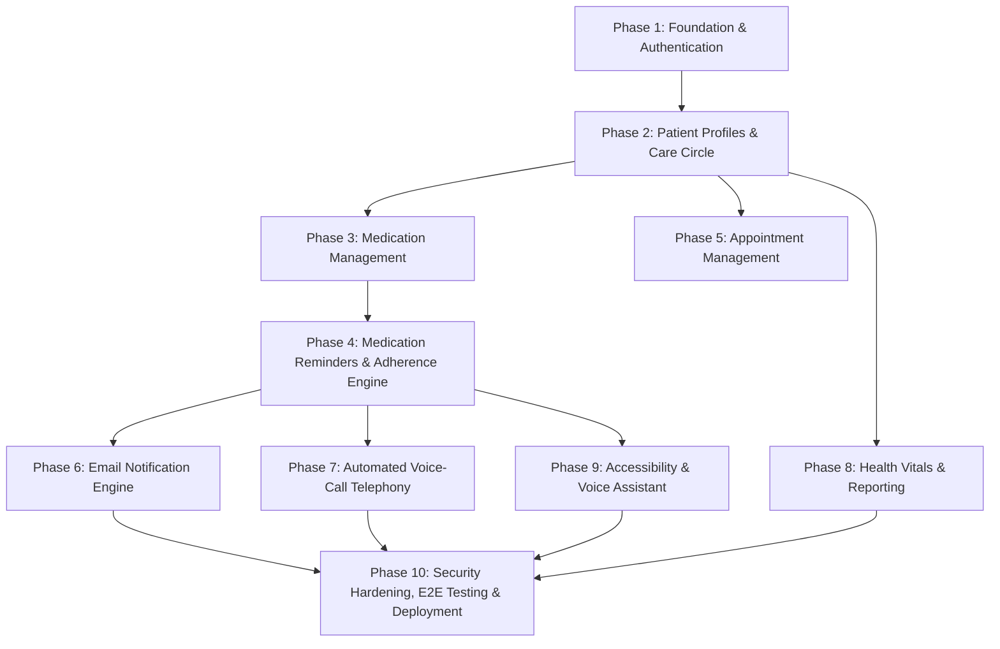

# CareNest – Phased Implementation & Engineering Roadmap

---

## Phase Details

### Phase 1: Project Foundation & Authentication
- **Prerequisites**: Node.js 20+, PostgreSQL 16, Redis 7.2.
- **Deliverables**: Next.js 14+ App Router scaffold, Tailwind CSS configuration with CareNest design tokens, Prisma ORM schema initialization, Argon2id password hashing, JWT issue/refresh flow, Tablet Quick PIN unlock endpoint, Base UI components (Buttons, Inputs, Pill Badges conforming to 56px touch target standard).
- **Validation Checkpoint**: User registration, login, token refresh, and unit test suite passing.

### Phase 2: Patient Profiles & Care Circle
- **Prerequisites**: Phase 1.
- **Deliverables**: Patient profile CRUD, address/condition/allergy metadata management, Care Circle invitation code generation, invitation acceptance, RBAC & Patient Consent middleware, member permission matrix configuration.
- **Validation Checkpoint**: Admin invites family member; family member accepts code; permissions correctly restricted.

### Phase 3: Medication Management
- **Prerequisites**: Phase 2.
- **Deliverables**: Medication registry CRUD, dosage forms and pill appearance attributes, complex schedule rules (Daily, Interval, Specific Weekdays, Meal Relations), medication stock inventory and refill threshold tracking, duplicate prescription detection.
- **Validation Checkpoint**: Medication creation with 3 daily intake slots generates correct schedule entities and stock countdown.

### Phase 4: Medication Reminders & Adherence Engine
- **Prerequisites**: Phase 3, Redis.
- **Deliverables**: BullMQ background worker generating rolling 30-day `dose_occurrences`, adherence state machine (Pending $\rightarrow$ Due Now $\rightarrow$ Taken / Snoozed / Missed), atomic dose confirmation with distributed locking (Redlock), optimistic UI update on tablet dashboard, adherence streak calculation.
- **Validation Checkpoint**: Concurrency test verifying two simultaneous confirmations for the same dose never produce duplicate stock deductions or corrupt state.

### Phase 5: Appointment Management
- **Prerequisites**: Phase 2.
- **Deliverables**: Doctor registry, appointment scheduling, ride escort tracking (e.g. SilverRide status), reminder triggers at 48h, 24h, and 2h before visit.
- **Validation Checkpoint**: Appointment banner rendered on dashboard with verified escort badge and review prep drawer.

### Phase 6: Email Notification Engine
- **Prerequisites**: Phase 4.
- **Deliverables**: Resend integration behind `EmailProvider` adapter, React Email templates (Daily Family Digest, Refill Alert, Missed Dose Escalation), quiet hours suppression, retry policy with exponential backoff.
- **Validation Checkpoint**: Automated digest generated at 8 PM reflecting completed doses and vitals.

### Phase 7: Automated Voice-Call Telephony
- **Prerequisites**: Phase 4.
- **Deliverables**: Twilio integration behind `TelephonyProvider` adapter, outbound call queue in BullMQ, TwiML IVR webhook for voice reminder playback, DTMF keypad parser (`1`=Taken, `2`=Snooze, `0`=Bridge to Sarah), call outcome logging (`voice_call_records`), Answering Machine Detection (AMD).
- **Validation Checkpoint**: Simulated Twilio webhook test confirming DTMF `1` transitions dose to `TAKEN` and cancels escalation queue.

### Phase 8: Health Vitals & Reporting
- **Prerequisites**: Phase 2.
- **Deliverables**: Vitals logging (BP, Blood Glucose, SpO2, Temperature, Weight, Hydration counter), normal range indicators, daily/weekly charts via Recharts, clinical PDF export summarizing adherence and vitals for doctor consultations.
- **Validation Checkpoint**: Logging blood pressure displays "Normal Range" badge; PDF generator outputs clean clinical document.

### Phase 9: Accessibility & Voice Assistant
- **Prerequisites**: Phase 4, Phase 8.
- **Deliverables**: Persistent accessibility control bar (Text scale `A- / A+`, High-contrast mode toggle, Web Speech API "Read Aloud" button), Voice Assistant prompt with Web Speech Recognition (*"Hey CareNest, mark as taken"*), Google Gemini Flash API adapter for natural language queries (*"What medications do I have left today?"*).
- **Validation Checkpoint**: Voice command successfully confirms dose; screen reader reads daily schedule fluently.

### Phase 10: Security Hardening, Testing & Deployment
- **Prerequisites**: All previous phases.
- **Deliverables**: AES-256 field encryption for medical records, OWASP security audit, rate limiting with Redis token bucket, Playwright end-to-end tests across desktop, tablet, and mobile viewports, Docker containerization, CI/CD GitHub Actions workflow.
- **Validation Checkpoint**: 100% CI pipeline pass rate, zero critical vulnerabilities in audit.
