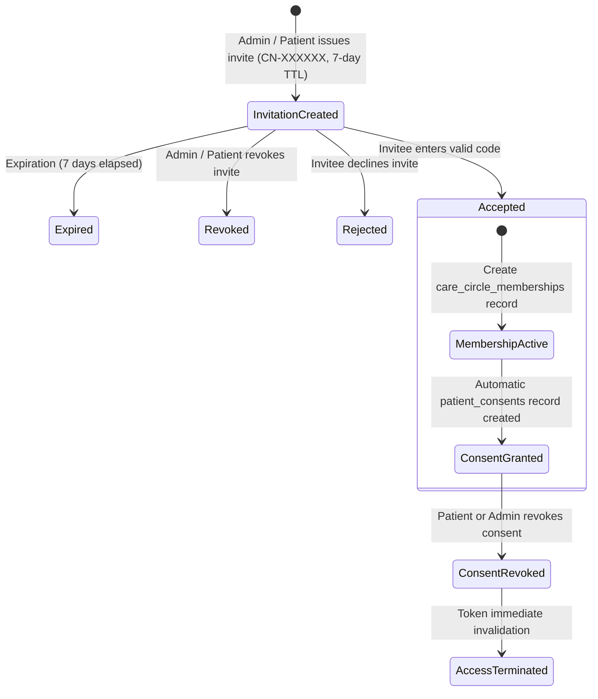

# CareNest – User Roles, Permissions & Patient-Centric Consent

## 1. Role Definitions

CareNest enforces a dual-tier authorization model: **System Role** (global identity level) and **Care Circle Scoped Role** (patient-specific permission scope).

| Role | Target Persona | Primary Responsibilities & Boundaries |
| :--- | :--- | :--- |
| **Elderly Patient** | Senior receiving care | Center of all healthcare decisions. Full ownership of profile, schedule visibility, 1-click medication confirmation, direct audio/video calling to family, emergency SOS, and authority to grant or revoke caretaker access. |
| **Family Administrator** | Adult child, legal guardian, or power of attorney | Manages patient Care Circle, invites and provisions permissions for visiting nurses/caretakers, configures medication regimens and schedules, monitors real-time adherence, receives Tier 2 escalations. |
| **Family Member** | Extended family (grandchildren, siblings) | Read-only visibility into patient daily well-being, receives daily family summaries, exchanges daily family notes, initiates direct video/audio check-in calls. Cannot alter medical prescriptions without explicit admin delegation. |
| **Caretaker / Visiting Nurse** | Professional in-home aide, visiting RN | Views assigned medication routines, marks doses administered during shifts, enters clinical observations and handover logs, views doctor appointment escort instructions. Cannot invite new members or revoke permissions. |
| **Healthcare Professional** | Cardiologist, Primary Care Physician (PCP) | Authorized clinical access. Reviews verified adherence histories, vital sign charts (BP, glucose), amends clinical dosing instructions, records clinical consultation notes. Cannot view personal family messages. |

---

## 2. Granular Permissions Matrix

| Capability / Action | Elderly Patient | Family Admin | Family Member | Caretaker / Nurse | Healthcare Pro |
| :--- | :---: | :---: | :---: | :---: | :---: |
| **View Personal Schedule** |  Yes |  Yes |  Yes |  Yes |  Yes |
| **Confirm Dose (Mark Taken)** |  Yes |  Yes |  No |  Yes |  No |
| **Snooze Dose (15m/30m)** |  Yes |  Yes |  No |  Yes |  No |
| **Add / Edit Medication** |  Yes |  Yes |  No |  No |  Approved Rx |
| **Discontinue Medication** |  Yes |  Yes |  No |  No |  Yes |
| **Invite Care Circle Member** |  Yes |  Yes |  No |  No |  No |
| **Revoke Care Circle Access** |  Yes |  Yes |  No |  No |  No |
| **View Health Vitals (BP/Sugar)** |  Yes |  Yes |  Yes |  Yes |  Yes |
| **Log Health Vital** |  Yes |  Yes |  No |  Yes |  Yes |
| **Post Daily Family Note** |  Yes |  Yes |  Yes |  No |  No |
| **Post Shift Handover / Obs** |  No |  No |  No |  Yes |  No |
| **Book / Edit Appointments** |  Yes |  Yes |  No |  View / Escort |  Follow-ups |
| **Trigger Emergency SOS** |  Yes |  Yes |  No |  Yes |  No |
| **Receive Escalation Call (Missed)**|  Self |  Primary |  No |  On-Duty |  No |
| **Export Clinical PDF Report** |  Yes |  Yes |  No |  No |  Yes |
| **View Audit Trail Logs** |  Yes |  Yes |  No |  No |  Scoped |

---

## 3. Patient-Controlled Consent & Delegation Architecture

1. **Explicit Consent Records**: Every caregiver access requires a corresponding `patient_consents` record. If an elderly patient revokes consent via their dashboard, the member's session immediately loses access to all patient PHI.
2. **Break-Glass Emergency Protocol**: In an Emergency SOS event, pre-authorized emergency contacts receive immediate temporary elevated visibility into medications, allergies, and location without administrative delay. Every break-glass access generates a high-severity audit log.
3. **Audit Attribution**: When a dose is recorded as taken, the system logs both the actor ID (`confirmed_by_user_id`) and the intake method (`DASHBOARD_UI`, `VOICE_ASSISTANT`, or `TELEPHONE_DTMF`), preventing ambiguity during caregiver shift changes.

---

## 4. Care Circle Invitation & Consent Lifecycle

### Access Enforcement Rules:
- **Zero Pre-Acceptance Exposure:** An invited party cannot query or view any patient data until the code is formally accepted and consent status is `GRANTED`.
- **Consent Revocation Immediate Effect:** When consent is revoked (`DELETE /api/v1/patients/:id/consents/:id`), `consent-guard.ts` intercepts all subsequent requests for that patient ID and returns `403 Forbidden` (`CONSENT_REVOKED`).
- **Token Invalidation on Logout:** Calling `POST /api/v1/auth/logout` records the active token hash in `revoked_tokens`. Any subsequent request with that token is immediately blocked by `auth-guard.ts`.
