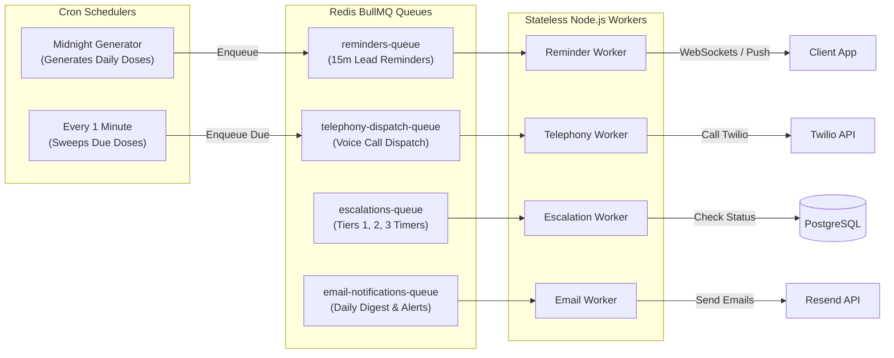

# CareNest – Telephony & Notification Engine Architecture

## 1. Provider-Independent Architecture & Hexagonal Ports

CareNest isolates all third-party telecom and email dependencies behind abstract interfaces:

```typescript
// src/modules/telephony/ports/telephony-provider.interface.ts
export interface OutboundCallOptions {
  toPhoneNumber: string;
  patientId: string;
  doseOccurrenceId?: string;
  ivrWebhookUrl: string;
  statusCallbackUrl: string;
  timeoutSeconds?: number;
}

export interface ITelephonyProvider {
  initiateOutboundCall(options: OutboundCallOptions): Promise<{ callSid: string }>;
  sendSMS(to: string, message: string): Promise<{ messageSid: string }>;
  generateTwiMLResponse(instructions: IVRInstruction[]): string;
}

// src/modules/notifications/ports/email-provider.interface.ts
export interface IEmailProvider {
  sendEmail(options: {
    to: string;
    subject: string;
    templateName: string;
    templateData: Record<string, any>;
  }): Promise<{ messageId: string }>;
}
```

---

## 2. Interactive Voice Response (IVR) State Machine

When an automated call is answered by an elderly patient, Twilio executes our webhook:

```
[Outbound Call Initiated by BullMQ]
                 │
                 ▼
  [Patient Answers: "Hello?"]
                 │
                 ▼
  [TTS Audio: "Hello Margaret. This is CareNest. It is time for your afternoon Metformin 500mg..."]
                 │
                 ▼
  [Gather DTMF (Digit 1, 2, or 0) / Speech Input ("Taken", "Later", "Help")]
         ├── 1 ("Taken") ──────────► [Atomic DB Transaction: Status TAKEN]
         │                            [Cancel Escalation Queue]
         │                            [Play: "Thank you! Have a wonderful afternoon."]
         │
         ├── 2 ("Later / Snooze") ──► [Update status: SNOOZED for 15m]
         │                            [Enqueue delayed retry in BullMQ]
         │                            [Play: "Understood. We will call you in 15 minutes."]
         │
         ├── 0 ("Help / Call") ─────► [<Dial> Primary Caretaker Phone (+1-555-SARAH)]
         │                            [Bridge call directly]
         │
         └── [No Input / Timeout] ──► [Log: NO_RESPONSE]
                                      [Trigger Tier 2 Caregiver Escalation]
```

### Critical Telephony Adherence Rules:
- **An unanswered call is NEVER counted as taken.**
- **Voicemail detection (AMD - Answering Machine Detection)**: If machine audio is detected (`AnsweredBy == 'machine_start'`), Twilio does not gather input; instead, it leaves a gentle reminder voicemail and marks the call attempt as `VOICEMAIL_LEFT`, leaving the dose status as `DUE_NOW`.
- **Speech Recognition Fallback**: Seniors with severe arthritic tremors can speak: *"I took it"* or *"Call Sarah"*, processed via Twilio Speech Recognition with fallback to DTMF digits.

---

## 3. Asynchronous Job & Worker Architecture (BullMQ)



### Quiet Hours & Retry Policy
- **Quiet Hours Enforcement**: No automated voice calls or loud SMS notifications are dispatched between `quiet_hours_start` (default 10:00 PM) and `quiet_hours_end` (default 7:00 AM) in the patient's local timezone, unless an explicit Emergency SOS is triggered.
- **Retry Exponential Backoff**:
  - Voice Call No Answer: Retry at +10 minutes (maximum 2 retries).
  - Webhook Delivery Failures: Exponential backoff with jitter ($5s, 30s, 2m, 10m$).
