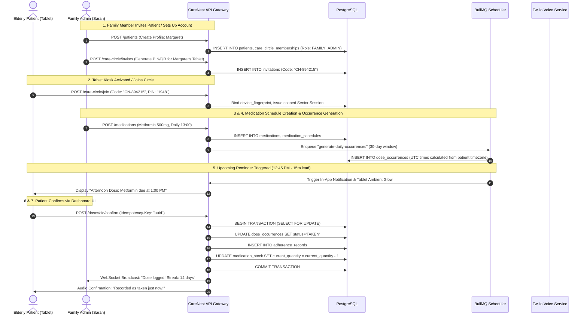
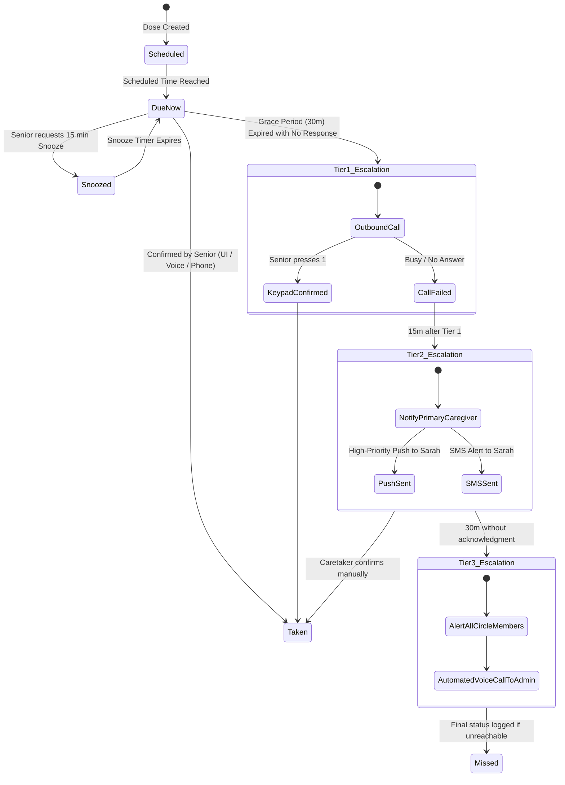

# CareNest – Critical Business Logic & Workflows

## 1. Concurrency Control & Adherence Integrity

In multi-generational healthcare management, multiple actors (patient on a tablet, caretaker on a phone, automated telephony service, and scheduled cron jobs) may interact with the same medication record within seconds of each other. CareNest enforces strict concurrency controls:

1. **Distributed Mutex (Redis Redlock)**:
   - When a confirmation request arrives (via HTTP, Voice, or Twilio Webhook), a distributed lock is acquired on `lock:dose:<dose_occurrence_id>` with a 5000ms TTL.
   - Any concurrent request for the same dose waits or is safely rejected as a duplicate.
2. **Database Row-Level Locking (`SELECT FOR UPDATE`)**:
   - Inside the PostgreSQL transaction, `dose_occurrences` is locked with `FOR UPDATE`.
   - The system checks if `status == 'TAKEN'`. If already taken, the transaction aborts with a graceful response: `"Dose already recorded as taken at <timestamp> by <actor>"`.
3. **Idempotency Keys**:
   - Every mutation accepts an `Idempotency-Key` header. Repeated button presses from senior tremors or network retries are deduplicated at the gateway.

---

## 2. Detailed Workflows (1 through 12)

### Workflow 8 & 9: Missed Dose Escalation Engine

### Detailed Workflow Step Summaries:
1. **Family Admin Invites Patient**: Adult daughter creates profile for parent; system provisions initial patient sovereignty records.
2. **Joining Care Circle**: Caretaker receives secure 6-character alphanumeric code; joins with granular scope (e.g. nurse can view vitals and mark doses, but cannot edit family notes).
3. **Medication Schedule Creation**: Prescriptions entered with frequency, dosage form, pill visual identifiers, and food constraints.
4. **Scheduled Dose Occurrence Generation**: Rolling cron calculates exact UTC timestamps adjusting for daylight savings in patient's registered timezone.
5. **Upcoming Reminder Dispatch**: 15 minutes before intake, tablet UI transitions card from upcoming to active, softly playing chime if audio readout is enabled.
6. **Confirmation via Dashboard or Keypad**: Senior taps primary 60px "✓ I Have Taken This" button, or answers automated phone reminder and presses DTMF `1`.
7. **Adherence Update**: Atomically updates `dose_occurrences`, creates immutable `adherence_records`, deducts medication stock, and checks if remaining pills are below `refill_threshold`.
8. **Missed Dose Escalation**: If grace period elapses without confirmation, BullMQ worker triggers Tier 1 automated telephone call. If unanswered, escalates to Tier 2 caregiver push notification and SMS.
9. **Family Email Notification**: Daily digest sent at 8:00 PM summarizing adherence score, vitals, and notes; immediate alerts sent on Tier 2 escalation.
10. **Doctor Appointment Advance Reminders**: Automated alerts at 48h, 24h, and 2h prior to visit, verifying transportation escort status (`SilverRide`).
11. **Caretaker Records Observation**: Visiting nurse logs morning vitals and shift handover notes; flags `requires_admin_review` if blood pressure exceeds systolic 140.
12. **Patient Revokes Access**: Elderly patient selects Care Circle member $\rightarrow$ Revoke. All active JWTs for that relationship are revoked in Redis blacklist, and future API requests fail with `403 Forbidden`.
